# Архітектура Home Dashboard — Archify

Навчальний набір із дев'яти схем, створених офіційним генератором [tt-a1i/archify](https://github.com/tt-a1i/archify). Пояснення українською; службові кнопки Viewer використовують англійський fallback Archify.

**Почніть із [загальної інтерактивної схеми](overview.html)** або [навчальної сесії](../learning-session.md). HTML можна завантажити й відкрити локально без встановлення Archify. GitHub показує SVG безпосередньо, а HTML — як файл; для інтерактивного перегляду завантажте весь каталог, зберігши назви сусідніх файлів.

## Маршрут схем

| № | Питання | Інтерактивна схема | Зображення для GitHub | Вихідний JSON |
| --- | --- | --- | --- | --- |
| 1 | Із чого складається система? | [Огляд](overview.html) | [SVG](overview.svg) | [JSON](overview.json) |
| 2 | Як HTTP-дані потрапляють на екран? | [Взаємодія](interaction.html) | [SVG](interaction.svg) | [JSON](interaction.json) |
| 3 | Що відбувається при зміні міста? | [Локація й погода](location.html) | [SVG](location.svg) | [JSON](location.json) |
| 4 | Як узгоджуються карта та значки? | [Тривоги](alerts.html) | [SVG](alerts.svg) | [JSON](alerts.json) |
| 5 | Коли застосовується вибір відключень? | [Відключення](energy.html) | [SVG](energy.svg) | [JSON](energy.json) |
| 6 | Як телефон налаштовує пристрій? | [Wi-Fi](wifi.html) | [SVG](wifi.svg) | [JSON](wifi.json) |
| 7 | Як працюють теми, сон і пробудження? | [Екран](display.html) | [SVG](display.svg) | [JSON](display.json) |
| 8 | Що означає перезапуск оновлень? | [Recovery](recovery.html) | [SVG](recovery.svg) | [JSON](recovery.json) |
| 9 | Як пов'язані основні структури C? | [Модель даних](types.html) | [SVG](types.svg) | [JSON](types.json) |

## Загальна схема



Три незалежні service workers публікують перевірені дані у спільний стан у RAM. LVGL читає його копію раз на секунду. Гілка налаштувань на схемі показує логічний виклик через Data API: NVS-запис виконують `dashboard_location` і `dashboard_energy` до публікації нового покоління. `data_supervisor` стежить за heartbeat кожного worker.

## Взаємодія задач та UI



HTTP та парсинг виконуються поза коротким `data_lock`. Для погоди й графіка публікація перевіряє покоління вибору. UI сам запитує snapshot; worker не викликає LVGL. Деталі тривог копіюються окремо з перевіркою сумісності.

## Локація й погода



Місто спершу зберігається в NVS. Лише успішний commit змінює поточну локацію та її покоління. Після A → B → A запізніла відповідь першого A відкидається. Помилка NVS зберігає попередній вибір. Зміна міста не змінює налаштування відключень і не обходить backoff.

## Тривоги та карта



Карта й `active.json` мають одного власника, окремі кеші та спільний ліміт 6 запитів за 60 с. Зміна карти інвалідує старі details; `304` успішний лише за валідного кешу. Значки означають типи загроз територій, а не позиції цілей. Карта має fixed fit без zoom/pan/pinch. Історія тривог не входить у runtime-збірку.

## Відключення



Область → оператор → черга змінюють UI draft. Після натискання черги вся трійка записується одним JSON; до успішного commit старий вибір залишається застосованим. Запити каталогу і графіка виконує `energy_data`, зі своїм backoff. Каталог має власне покоління; пізня відповідь не відновить закритий майстер.

## Wi-Fi



Телефон підключається до SoftAP пристрою. Локальна HTTP-форма перевіряє endpoint AP, setup code і поля та передає credentials provisioning manager. Event loop зберігає конфігурацію після успішного підключення. Вебформа не є браузерною версією дашборда.

## Режими екрана



Темою задаються палітри й layout. Нічний режим 22:00–07:00 знижує яскравість до 8%; ECO після 60 с без активності вимикає підсвічування. Перший дотик будить екран і поглинається до відпускання. Alert wake потребує свіжого переходу до R/P, попередньо відомого неактивного стану та ввімкненої опції.

## Відновлення



45 с без heartbeat ініціюють recovery; 15 с від запиту без завершення дають `FAILED`. Це не означає видалення задачі: `pending` зберігається. Пізніше worker може відновитися та завершити cleanup. Кнопка для групи чекає всіх підтверджень; після завершення діє cooldown 5 с. Повний reboot — окрема дія з підтвердженням.

## Модель даних



`record` у цьому типі діаграми означає C `typedef struct`. Методи та успадкування не вигадуються. Snapshot містить графік і selection за значенням, а на незмінний елемент каталогу міста посилається через const pointer. У підписах полів деякі типи скорочено; точні імена й контракти — у [довіднику модулів](../architecture-reference.md).

## Відтворення та перевірка

Схеми прив'язані до source commit `271ce3279edf3d1160f0a0efc9ea83e19b3943ab`. Поточні користувацькі зміни `docs/performance-review.md` не були джерелом схем і не змінювались. Версія генератора зафіксована commit `62f3a995eb26ee23f784bdea4a7992340078e9be` репозиторію Archify.

Після завантаження Archify у `build/archify-tool` запускайте з кореня проєкту, підставивши тип та ім'я JSON:

```powershell
$env:ARCHIFY_UPDATE_CHECK_DISABLED = '1'
node build/archify-tool/archify/bin/archify.mjs finalize architecture docs/archify/overview.json docs/archify/overview.html --repo-root . --quality showcase --json --out-dir build/archify-review-new
node build/archify-tool/archify/bin/export-svg.mjs docs/archify/overview.html build/overview-new.svg light
```

Типи: `architecture` для overview/alerts/display, `sequence` для interaction/location/energy/wifi, `lifecycle` для recovery, `class` для types. Для нового browser evidence після зміни кандидата вибирайте новий `--out-dir`. SVG exporter вимагає новий вихідний файл. За потреби `ARCHIFY_CHROME` задає шлях до Chrome/Edge. Не редагуйте згенерований HTML вручну — змінюйте JSON та повторно запускайте `finalize`.

Кожен HTML має `*.delivery.json`, `*.finalize-summary.json`, повний finalize receipt і browser receipt. Вони описують автоматичну перевірку конкретних байтів артефакту, а не перевірку firmware на платі. Доступність зовнішніх API та реальні затримки в цій роботі не вимірювались. Вертикальне розташування sequence-повідомлень передає порядок, а не виміряний час.

Viewer Archify — сторонній код; дивіться [Apache-2.0](ARCHIFY-LICENSE.txt), [MIT](ARCHIFY-LICENSE-MIT.txt), [NOTICE](ARCHIFY-NOTICE.txt) та [сторонні компоненти](ARCHIFY-THIRD-PARTY-NOTICES.md). Папка генератора у `build/` не входить у документаційний набір. [Склад набору для завантаження на GitHub](../github-documentation.md).
