# Архітектура Home Dashboard

Home Dashboard — прошивка ESP32-S3 на C, ESP-IDF та LVGL для Guition ESP32-4848S040C_I. Пристрій сам отримує дані зовнішніх сервісів через HTTPS і показує їх на сенсорному дисплеї 480 × 480. Сервер застосунку й браузер для щоденної роботи не потрібні.

[Навчальна сесія](learning-session.md) · [Дев'ять схем Archify](archify/README.md) · [Довідник модулів і структур](architecture-reference.md) · [Запуск](setup.md)

## Загальна схема

[Відкрити інтерактивну версію](archify/overview.html). У вузлах є посилання на код і переходи до детальних схем. GitHub показує SVG; для локального інтерактивного перегляду завантажте HTML-файли разом.

Основний потік: три незалежні service workers → перевірка відповіді → спільний знімок у RAM → LVGL UI. UI читає копію даних раз на секунду. Workers не звертаються до LVGL-об'єктів, а UI не виконує HTTPS. Навіть каталоги майстра відключень завантажує фонова задача.

Гілка налаштувань на схемі позначає виклик Data API з UI. Реальний запис NVS виконують модулі location/energy, після чого Data API публікує новий вибір. Це не окремий сервер чи фонова задача сховища.

## Запуск

[app_main](../main/dashboard.c) задає київський TZ, запускає LCD/touch/LVGL port і LEDC підсвічування, потім Wi-Fi, data workers та екран під LVGL lock. RGB pixel clock встановлюється в 14 MHz, щоб лишити пропускну здатність PSRAM для bounce buffers під час Wi-Fi.

Wi-Fi ініціалізує стандартний NVS та default event loop. Data layer завантажує місто, вибір відключень і два ключі. Supervisor і три workers чекають startup barrier: працювати можна лише після створення всієї групи. При частковій помилці очікувальні задачі видаляють себе; повторне створення потребує reboot. Помилка data-start логується без негайного abort, тому UI може бути доступний і без workers.

## Контексти виконання та власність

| Контекст | Власні ресурси | Вихід |
| --- | --- | --- |
| LVGL task | Екрани, callbacks, UI draft, display mode | Запити до Data API та Wi-Fi |
| weather_data | HTTP client, body, розклад погоди | Температура і стан джерела |
| alerts_data | Два endpoint, незалежні кеші, спільний бюджет, покоління карти | Статуси, локальні записи, маски загроз |
| energy_data | HTTP client, великий body, графік та запити каталогів | Графік і каталог поточного покоління |
| data_supervisor | Один SNTP, опитування heartbeat щосекунди | Recovery відповідного worker |
| ESP event loop | Wi-Fi та provisioning lifecycle | Атомарний Wi-Fi state |

Короткий data_lock захищає latest, копію деталей і recovery. HTTPS, NVS-запис і парсинг виконуються поза ним. Каталог має окремий catalog_mutex: великі PSRAM-копії не тримають spinlock із вимкненими перериваннями. Mutex не утримують під час HTTPS. Активний HTTP client закриває тільки його worker.

## Джерела і свіжість

| Джерело | Звичайне опитування після успіху | Межа віку у snapshot |
| --- | --- | --- |
| Open-Meteo / обране місто | 600 с | 1200 с |
| Alerts.in.ua / карта | 25 с | 90 с |
| Alerts.in.ua / active.json | 60 с; можливий urgent | 150 с + сумісність поколінь |
| Alerts.energy / обраний графік | 300 с | 900 с |

HTTP починається за Wi-Fi, наявного потрібного ключа, валідного часу та дозволеного розкладу/backoff. Помилка чи offline можуть позначити дані застарілими раніше за вікову межу. Data state розділяє WAITING, FRESH, STALE, UNAVAILABLE, NO_TOKEN та AUTH_ERROR. Збережене останнє значення не дорівнює свіжому значенню.

UTC потрібен TLS і календарю. Київський час задає правило TZ, зашите у firmware: EET-2EEST,M3.5.0/3,M10.5.0/4. Вік, дедлайни, cooldown і heartbeat використовують монотонний esp_timer_get_time. Дата графіка зіставляється з локальною датою; це не той самий годинник, що вік даних.

Карта та active.json мають окремі Last-Modified кеші. 304 підтверджує лише валідний сумісний кеш. Спільний бюджет пристрою — 6 запитів за ковзні 60 с. HTTP 401/403/429 встановлюють паузи, числовий Retry-After враховується. Зміна вибору та recovery не скидають сервісний backoff.

## Вибір міста та відключень

Локальний каталог містить 463 міста й 27 територій. Стабільний ID — КАТОТТГ, координати зберігаються з точністю 0,0001°, region є ISO-індексом карти. UID Alerts.in.ua — інший ідентифікатор. Київ/Київщина та Севастополь/Крим розділені.

Спершу NVS commit, потім новий вибір і generation під коротким lock. Worker фіксує generation перед HTTPS й порівнює перед публікацією. Це захищає навіть A → B → A. Зміна міста очищує попередню температуру, оновлює погоду й локальну вибірку alerts, але не змінює графік енергії.

Майстер енергії має окремий draft: область → оператор → черга. Лише вибір черги записує всю трійку одним JSON. Каталог має власне generation, окреме від energy_generation застосованого графіка. Черги отримуються з записів shutdowns, тому список не гарантовано повний. Fallback без валідного збереження — Дніпропетровська / ЦЕК / 5.2.

## Екран і карта

dashboard_screen поєднує навігацію, callbacks, рендеринг і UI-стан. Чисті моделі виділені в display_mode, theme, map_view та парсери; це модульний C-код, без класів та успадкування.

Карта має fixed fit: непорожні bounds вихідного RLE-растра проєктуються у 480 × 327 на y76..402. Zoom, pan та pinch немає. Canvas 480 × 480 створюється ліниво в PSRAM. Піктограми — категорії загроз території, а не позиції цілей. Старі чи несумісні details не відображаються як свіжі значки. Runtime історії та екрана деталей немає; legacy history source/test збережені поза збіркою.

Списки міст, областей і каталогів використовують до 8 reusable рядків та extent замість сотень постійних кнопок. Перебудова/звільнення після виходу відбувається з UI timer поза touch callback. Статичні assets і атрибуція: [main/assets](../main/assets/README.md).

## Пам'ять і NVS

| Ресурс | Організація |
| --- | --- |
| Звичайний body погоди/карти | 2048 байтів локального буфера worker |
| active.json | 64 KiB PSRAM |
| Alerts.energy | 192 KiB PSRAM |
| Повний RGB565 canvas | 480 × 480 × 2, приблизно 450 KiB |
| Каталог енергії | До 64 записів; scratch/shared у PSRAM, UI copy лише в майстрі |
| Стек worker / supervisor | Аргументи xTaskCreate: 10240 / 3072 байти |

CONFIG_MBEDTLS_EXTERNAL_MEM_ALLOC переносить TLS allocation у PSRAM. CONFIG_SPIRAM_MALLOC_ALWAYSINTERNAL=0 дає пріоритет PSRAM звичайним malloc, включно з UI. INTERNAL/DMA allocation, стеки й апаратний AES усе ще потребують внутрішньої RAM: вільна PSRAM не усуває цей ліміт.

| Partition | Namespace / key | Дані |
| --- | --- | --- |
| nvs | dashboard_wifi / station_v1 | Wi-Fi credentials |
| nvs | dash_location / city | КАТОТТГ ID міста |
| nvs | dash_energy / selection | JSON трійки й назв |
| nvs | dash_display / flags, theme | Режими й тема |
| dash_keys | credentials / alerts_token | Ключ Alerts.in.ua |
| energy_keys | credentials / energy_key | Ключ Alerts.energy |

Ключі вводяться через [USB-утиліту](../main/tools/README.md) і читаються перед запуском workers. Окремі partitions розділяють зберігання; це не твердження про шифрування flash. Live snapshots і HTTP-кеші зберігаються в RAM, не в історичній базі даних.

## Recovery і межі перевірки

Асинхронний HTTP перевіряє скасування між ESP_ERR_HTTP_EAGAIN, віддає CPU на 20 мс і має загальний дедлайн 20 с. Таймаут операції — 4,5 с, для energy — 6,5 с. Це кооперативна модель: операція SDK, яка не повертається, може завадити перевірці дедлайну.

45 с без heartbeat запитують recovery тільки відповідного сервісу. 15 с від запиту без завершення дають FAILED; pending зберігається, тому нове натискання не створить новий запит. Якщо worker пізніше повернеться, він може завершити recovery. Кнопка групи чекає підтверджень усіх; cooldown — 5 с. Кеші й backoff збережені. Автоматичного reboot немає: він потребує підтвердження в UI; при зависанні всього пристрою потрібен Reset.

Схеми перевіряють модель і посилання на commit, а не роботу плати. Host-тести парсерів, generation і конкурентних workers описані в [tests/dashboard-data.md](../tests/dashboard-data.md). LCD, touch, DMA/TLS та поведінку з реальними сервісами перевіряють окремо на [фізичному пристрої](../tests/board-smoke.md).
